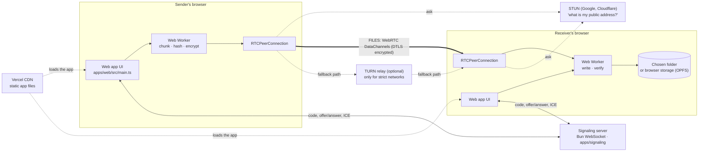
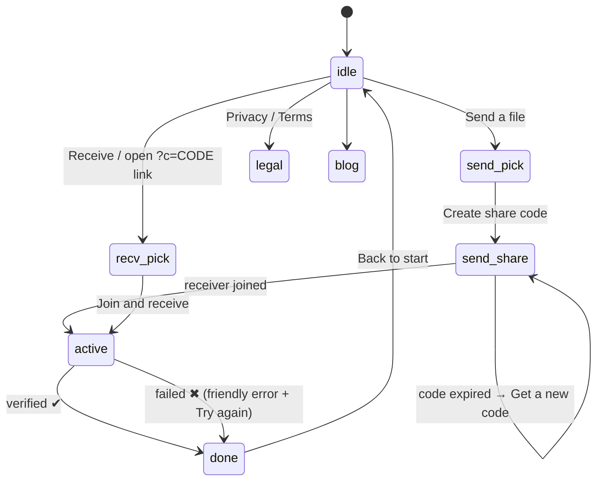

# DropBeam: project map

A one-page map of how DropBeam is put together. Read the top for the big
picture, and go deeper only where you need to. The diagrams are Mermaid, so
GitHub draws them as pictures.

---

## 1. The whole system in one picture



**In plain words:**

- **Vercel** serves the website: HTML, CSS and JavaScript. It never sees a file.
- **Signaling server:** a tiny matchmaker. It hands out a code and passes
  "here's how to reach me" notes between the two browsers. It never sees a
  file.
- **STUN:** a free public service that tells each browser its public address,
  so the two can find each other.
- **TURN:** a relay that is used only when two networks refuse to talk
  directly (some offices, some mobile carriers). The bytes stay encrypted
  through it, but this is the one piece that costs money per GB.
- **The files:** they travel browser to browser. Nothing is stored in the
  middle.

---

## 2. One transfer, step by step

```mermaid
sequenceDiagram
    autonumber
    participant S as Sender
    participant SIG as Signaling server
    participant R as Receiver

    S->>SIG: create room
    SIG-->>S: code K7-9P3-MX2A (valid 30 min)
    Note over S: shows code, QR, link
    R->>SIG: join K7-9P3-MX2A
    SIG-->>S: peer joined
    S->>SIG: WebRTC offer + ICE candidates
    SIG->>R: (relayed)
    R->>SIG: answer + ICE candidates
    SIG->>S: (relayed)
    Note over S,R: Direct link is up. Signaling's job is done.
    S->>R: manifest (names, sizes, SHA-256, salt?)
    R->>R: free-space check, look for .dbpart partials
    R->>S: resume offsets (if any)
    loop each 64 KB chunk, across 4 data lanes
        S->>R: [16-byte header][payload]
        R-->>S: credit (every 1 MiB written; sender pauses at 16 MiB in flight)
    end
    S->>R: file-end, complete (control channel)
    R->>R: wait until EVERY byte arrived, re-read, verify SHA-256
    R->>R: rename .dbpart → final name ("photo (1).jpg" on clash)
    R->>S: complete-ack
    Note over S: shows "Verified"
```

---

## 3. Screens (UI state machine)



All stages are sections inside `apps/web/index.html`. `main.ts` shows one at a
time.

---

## 4. Folder map: what each file is for

```
DropBeam/
├── vercel.json                 Vercel: build apps/web from repo root, headers, SPA rewrite
├── render.yaml                 Render blueprint for the signaling server (free plan)
├── package.json / bun.lock     Bun workspaces
│
├── apps/
│   ├── web/                    ★ THE PRODUCT (what users open)
│   │   ├── index.html          Every screen's markup
│   │   ├── src/main.ts         Brain of the UI (~2,100 lines):
│   │   │                         config + banner, ICE servers, session lifecycle,
│   │   │                         send/receive flows, errors, stepper, progress,
│   │   │                         code expiry, history, inbox (OPFS) Save/Share/Clear
│   │   ├── src/styles.css      Neobrutalist look (cream paper, black borders, hard shadows)
│   │   ├── public/sw.js        Service worker: app loads instantly, works offline
│   │   ├── public/manifest…    PWA "install as app"
│   │   └── .env.example        VITE_SIGNALING_URL, VITE_TURN_*
│   │
│   └── signaling/              ★ THE MATCHMAKER
│       ├── src/server.ts       HTTP + WebSocket, /healthz, rate limits, optional static hosting
│       ├── src/room.ts         Rooms: create/join/leave, 30-min TTL, capacity, pruning
│       ├── src/codes.ts        Human-friendly codes (K7-9P3-MX2A), ids, tokens
│       ├── src/rateLimit.ts    Token bucket per IP
│       ├── src/config.ts       Validated env settings, client IP via TRUST_PROXY_HOPS
│       ├── Dockerfile          Production container
│       └── test/               codes, rate limit, server
│
├── packages/
│   ├── protocol/               Shared "language" both sides speak
│   │   ├── src/signaling.ts    Signaling message types
│   │   ├── src/transfer.ts     Manifest, control messages, 16-byte frame header, chunk size, flow-control limits
│   │   └── src/validate.ts     Runtime validation of everything from the network
│   │
│   └── transfer/               ★ THE ENGINE
│       ├── src/sender.ts       Read file → hash → (encrypt) → 4 lanes; wait for complete-ack
│       ├── src/receiver.ts     Count bytes, write, re-read + verify, capacity check, abort
│       ├── src/sinks/fsAccessSink.ts   Disk writer: .dbpart, resume, safe names, quota
│       ├── src/checksum.ts     Streaming SHA-256 (flat memory)
│       ├── src/encryption.ts   Optional AES-GCM-256 + PBKDF2
│       ├── src/signalingClient.ts  WebSocket client: buffering, keep-alive, close handling
│       ├── src/worker/         Runs the engine off the main thread
│       └── test/               engine (reorder, integrity, resume, aborts), checksum
│
└── docs/
    ├── MAP.md                  ← you are here
    ├── ROADMAP.md              To-dos, test plan, features, scaling, Docker, caching
    ├── PRODUCT.md              What it's for, competitors, costs, growth plan
    ├── PHASES.md               What is being built now, phase by phase
    ├── audit/                  External audit, our response, verification records
    └── adr/                    Architecture decisions
```

Other docs at the root: `README.md` (overview), `SETUP.md` (run locally),
`DEPLOY.md` (go live), `FORK.md` (contribute), `FEATURES.md` (user-facing list).

---

## 5. Where data lives

| Data | Where | How long | Who can see it |
|---|---|---|---|
| File contents | Sender's disk → wire → receiver's disk | Until the user deletes | Only the two devices (TURN sees encrypted bytes only) |
| Room code, device name, IP | Signaling server memory | Room TTL (30 min), never written to disk | Server operator |
| Partial downloads `.dbpart` | Receiver's folder / OPFS | Until finished, resumed or cleared | Receiver |
| Files received into browser storage | OPFS `dropbeam-inbox` | Until Save + Clear, or 24 h | Receiver's browser |
| Recent transfers list | `localStorage` `dropbeam.history` | Up to 20 entries, Clear button | That device only |
| App code | Vercel CDN + service-worker cache | Until next deploy | Public |

---

## 6. Numbers worth knowing

| Thing | Value | Where it's set |
|---|---|---|
| Chunk size | 64 KiB − 64 B | `packages/protocol/src/transfer.ts` |
| Data lanes | 4 (+1 control) | `DEFAULT_PARALLEL_LANES` in `packages/protocol/src/transfer.ts` |
| Code lifetime | 30 min (max 4 h) | `apps/signaling/src/server.ts` |
| Max rooms per server | 10,000 (`MAX_ROOMS`) | env |
| Peers per room | 2 (`ROOM_CAPACITY`) | env |
| Flow-control window | 16 MiB in flight, credit every 1 MiB | `packages/protocol/src/transfer.ts` (ADR-001) |
| Client IP behind proxies | `TRUST_PROXY_HOPS` (0 = socket address) | env (ADR-003) |
| Rate limits per IP | 30 msgs burst, 15/s; 5 room-creates burst, 1 per 10 s | `server.ts` |
| Max signaling message | 64 KiB | `MAX_MSG_BYTES` |
| Connection timeout | 30 s | `main.ts` |
| Size warnings | 2 GB, 10 GB | `main.ts` |
| Browser-storage cleanup | 24 h | `main.ts` |
