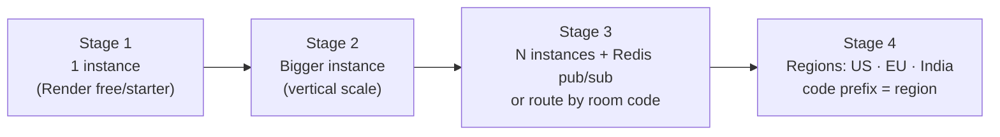

# DropBeam: roadmap

Four lists: what to **do** before and after launch, what to **test**, what
**features** to add, and how the system **scales** (many users, caching,
Docker, storage). Each item has a priority:

- **P0:** before or at launch
- **P1:** in the first months
- **P2:** when there's traction

---

## 1. To-do (engineering and launch)

### P0: before going public

- [ ] **Merge `phase-0-1-deploy-and-connection` into `main`** (open a PR) so
      Vercel and Render auto-deploy from `main`.
- [ ] **Deploy signaling** (Render free, per `render.yaml`) and set
      `VITE_SIGNALING_URL` in Vercel. Add an UptimeRobot ping on `/healthz`
      every 5 min so Render's free plan doesn't sleep. A cold start takes
      about 30–60 s and makes the first visitor think the site is broken.
- [ ] **Buy the domain** and point it at Vercel. Give signaling its own
      sub-domain, e.g. `ws.dropbeam.com` → Render. Then rebuild with
      `VITE_SIGNALING_URL=wss://ws.dropbeam.com/ws`.
- [ ] **Fix IP detection behind proxies.** `server.ts` trusts the *first*
      `X-Forwarded-For` value, which a client can fake to dodge the rate
      limits. Use the value the platform's proxy appends instead (the
      right-most entry, or Render's documented header).
- [ ] **Loosen per-IP limits for shared networks.** A college, office or
      mobile carrier (CGNAT) can put hundreds of people behind one IP, and
      "5 rooms, then 1 per 10 s" will block them. Key the limiter on IP +
      device id, or raise the burst and watch `/healthz`.
- [ ] **Add a Content-Security-Policy header** in `vercel.json`: script-src
      self, connect-src the signaling host + STUN/TURN. This is especially
      important before adding any ad script.
- [ ] **Terms of use + abuse contact** page: what's forbidden, and an email
      for reports. It's needed for AdSense and for app stores later.
- [ ] **SEO fixes once the domain is known.** These are found in the current
      files:
  - `public/sitemap.xml` uses relative `<loc>/about</loc>` URLs. Google
    requires full URLs (`https://dropbeam.com/about`).
  - `public/robots.txt` has `Sitemap: /sitemap.xml`. It must also be a full
    URL.
  - `index.html` points `og:image` at `/og.png`, but only `og.svg` exists.
    Add a 1200×630 PNG; WhatsApp, X and LinkedIn don't show SVG previews.
  - `<link rel="canonical" href="/">` should be the full URL.
- [ ] **CI:** a GitHub Actions workflow running `bun test`,
      `bun run typecheck` and `bun run build` on every PR.

### P1: first months

- [ ] **Split `main.ts`** (~2,100 lines) into modules: `session.ts`,
      `ui/stages.ts`, `inbox.ts`, `history.ts`, `errors.ts`, `ice.ts`. No
      behavior change, so it's easier to work on.
- [ ] **Short-lived TURN credentials:** a `/turn-credentials` endpoint on the
      signaling server that mints time-limited credentials (Cloudflare TURN or
      coturn `use-auth-secret`), instead of baking a static password into the
      public JS.
- [ ] **Privacy-respecting usage counts:** count transfers started,
      succeeded and failed, and the path type (LAN / P2P / TURN). Do it on the
      signaling server, with no cookies and no file names. You can't grow
      what you can't measure, and the TURN share decides your costs.
- [ ] **Uptime and error alerts:** UptimeRobot email/Telegram alert for
      `/healthz` and for the site.
- [ ] **Accessibility pass:** keyboard-only flow, screen-reader labels on the
      progress and stepper, colour contrast.
- [ ] **i18n:** extract strings and start with Hindi, Telugu and Spanish.

### P2: with traction

- [ ] Multi-region signaling (see §4).
- [ ] Opt-in, anonymous crash reports.
- [ ] Self-host bundle (`docker compose up`, see §5).

---

## 2. Test to-do

### 2a. Manual test checklist (do this on the deployed site)

Tick each cell. "✔" = verified OK, then **Save/Share** worked and the file
opens.

| # | Sender → Receiver | Network | Small (≤10 MB) | Medium (~500 MB) | Large (2–5 GB) |
|---|---|---|---|---|---|
| 1 | Chrome laptop → Chrome laptop (folder) | Same Wi-Fi | ☐ | ☐ | ☐ |
| 2 | Chrome laptop → iPhone Safari | Same Wi-Fi | ☐ | ☐ | — |
| 3 | iPhone Safari → Windows Chrome | Same Wi-Fi | ☐ | ☐ | — |
| 4 | Android Chrome → Mac Safari | Same Wi-Fi | ☐ | ☐ | — |
| 5 | Laptop on home Wi-Fi → phone on mobile data | Anywhere | ☐ | ☐ | — |
| 6 | Office/college network → home | Anywhere | ☐ | ☐ | — |
| 7 | Firefox → Edge | Same Wi-Fi | ☐ | ☐ | ☐ |

Scenarios, each once:

- [ ] QR scan opens the receive screen with the code filled in.
- [ ] Wrong code → clear "code not found" message.
- [ ] Code expires (wait 30 min, or leave it) → **Get a new code** works.
- [ ] Passphrase right → works. Passphrase wrong → both sides say "wrong passphrase".
- [ ] Cancel halfway → send the same file again → it resumes, not from 0.
- [ ] Turn Wi-Fi off mid-transfer → friendly error + **Try again**.
- [ ] Receiver closes the tab mid-transfer → sender stops within seconds.
- [ ] Same file twice into the same folder → second is `name (1).ext`.
- [ ] Phone screen locks mid-transfer → what happens? (Note it. iOS
      suspends background tabs.)
- [ ] File bigger than the phone's free space → refused *before* starting.
- [ ] Install as app (PWA) on Android and desktop and open it from the icon.
- [ ] Recent transfers list shows entries; Clear empties it.
- [ ] Red config banner does **not** appear on the live site.

### 2b. Automated tests to add

| Priority | Test | Why |
|---|---|---|
| P0 | GitHub Actions running the existing 29 tests | Catch breakage on every PR |
| P1 | **Playwright two-browser e2e**: start signaling + preview build, two browser contexts, send 5 MB, assert hash | The one test that proves the real thing works |
| P1 | Signaling: room expiry, rejoin with token, capacity full, `server-full` | Server logic only has 10 tests today |
| P1 | Frame parser fuzz: random/garbage bytes must never crash the receiver | Hostile peers |
| P2 | **Load test**: a script opening 5,000 WebSockets creating/joining rooms against a staging server | Know the real per-instance limit before a viral day |
| P2 | Cross-browser e2e on Playwright WebKit + Firefox | Safari is where most surprises live |
| P2 | Visual snapshot tests of each stage at 375 px and 1280 px | Layout regressions |

---

## 3. Features to add (ranked by user value ÷ effort)

| Rank | Feature | What the user gets | Effort | Notes |
|---|---|---|---|---|
| 1 | **Accept / decline prompt** | Receiver sees "Vara wants to send 3 files, 1.2 GB" before anything is written | S | Manifest already arrives first; add a UI gate |
| 2 | **Send text / links / clipboard** | Copy a link on the laptop, paste it on the phone | S | Tiny message over the control channel |
| 3 | **Folder sending** | Drop a folder, it arrives with its structure | M | `webkitdirectory` + relative paths in the manifest; the sink already sanitizes names |
| 4 | **Android "Share to DropBeam"** | Share from Gallery straight into DropBeam | S | PWA `share_target` in the manifest |
| 5 | **Nearby devices** | Devices on the same Wi-Fi see each other, with no code | M | Group by public IP on the signaling server (like Snapdrop); opt-in |
| 6 | **One sender → many receivers** | Teacher sends a file to the whole class | M–L | Rooms already allow 8 peers; the sender's upload is the bottleneck, so cap at ~5 or relay peer-to-peer |
| 7 | **Pause / resume button** | Pause on metered data | S | Resume logic already exists |
| 8 | **Dark mode** | Comfort | S | CSS variables |
| 9 | **Keep-alive across reload** | Accidental refresh doesn't kill the transfer | M | Room token rejoin + resume |
| 10 | **"Leave it for later" (store-and-forward)** | Recipient offline? Upload encrypted, they fetch within 24 h | L | Needs storage (§6) + abuse handling, and changes the "no server" promise. Make it opt-in and paid. |
| 11 | **Browser extension** | Right-click any file/link → DropBeam | M | |
| 12 | Native wrappers (iOS share extension, desktop tray) | Background transfers on phones | L | Only if browser limits hurt real users; old code is on `archive/native` |

**Deliberately *not* doing:** compressing files (photos and videos are
already compressed; it would only cost CPU on old laptops), accounts (they
break the "zero-account" promise), and permanent cloud storage (that makes
us Google Drive with worse economics).

---

## 4. Many users at once: how it scales

### What each part costs per user

| Part | Load per transfer | Limit |
|---|---|---|
| Website (Vercel CDN) | ~200 KB once, then cached by the service worker | Practically unlimited |
| Signaling | 1 WebSocket + ~20–60 small JSON messages, then idle | **One Bun instance comfortably holds tens of thousands of open sockets.** Confirm with the load test in §2b. |
| File bytes, direct | **Zero to us.** Users' own bandwidth | None |
| File bytes via TURN | Every byte passes through the relay | **Money**, see PRODUCT.md |

So "a lot of people on the site" is mostly free. The two things that bite are:

1. **One signaling instance.** Rooms live in that process's memory. Two
   instances behind a load balancer would split rooms: the sender lands on
   A and the receiver on B, and they never meet.
2. **TURN bandwidth** grows with usage.

### Scaling steps



- **Stage 1–2:** do nothing clever. Watch `rooms` on `/healthz`.
- **Stage 3, two options:**
  - **Room-code routing (simplest):** make the first character of the code
    say which instance owns it (`K…` → instance 1). The client connects to
    `wss://ws-1.dropbeam.com`. No shared state.
  - **Redis pub/sub:** any instance can serve any room; instances forward
    messages through Redis. Use Upstash or Redis Cloud free tiers to start.
- **Stage 4:** put signaling near users. Latency only affects the
  handshake, but India ↔ Oregon adds about a second.

---

## 5. Docker

**Today:** `apps/signaling/Dockerfile` builds a small, non-root production
image with a health check. Render uses it.

**To add (P2):** a `docker-compose.yml` for one-command self-hosting, e.g.
for offices, schools, ships and air-gapped labs:

```yaml
# sketch, not yet in the repo
services:
  signaling:   # apps/signaling, serving the built web app via WEB_ROOT
  caddy:       # HTTPS (tls internal on a LAN, Let's Encrypt on the internet)
  coturn:      # optional TURN relay
```

This gives a whole private DropBeam with `docker compose up`, HTTPS
included, so phones on the LAN can receive too.

---

## 6. Caching and storage

### Caching (already in place)

| Layer | What | Rule |
|---|---|---|
| Vercel CDN | `/assets/*` (hashed JS/CSS) | `immutable`, 1 year |
| Vercel CDN | `index.html`, `sw.js` | `no-cache` (always check for a new version) |
| Service worker | App shell | Network-first HTML, cache-first assets, so repeat visits load instantly and work offline |
| Files | **Never cached anywhere** | By design |

Nothing else needs caching. There is no database to put a cache in front of.

### Storage (S3 / AWS): only if we build "leave it for later"

DropBeam doesn't need storage today. If store-and-forward (feature #10)
happens:

- **Prefer Cloudflare R2 over AWS S3:** R2 doesn't charge for downloads
  (egress). S3's per-GB egress fee is the cost that hurts file-sharing
  services.
- **Encrypt in the browser before upload** (the AES-GCM code already
  exists), and put the key in the link's `#fragment`, which is never sent to
  the server. Then "we can't see your files" stays true.
- **Auto-delete after 24 h** (lifecycle rule), with a size cap (e.g. 2 GB
  free).
- **Legal weight:** hosting files means takedown requests (DMCA/IT Rules)
  and abuse reports, plus legal duties to report illegal content. Budget
  time for a report button and a response process *before* launching this.
